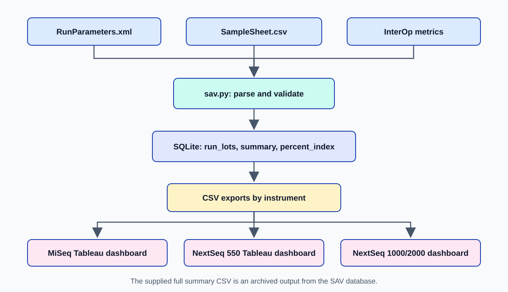

# Sequencing QC Analytics

Python and Tableau workflow for Illumina run quality monitoring on MiSeq, NextSeq 550, and NextSeq 1000/2000 instruments.



The primary workflow reads `RunParameters.xml`, `SampleSheet.csv`, and Illumina InterOp metrics from instrument run folders. The [`sav.py`](src/illumina_qc/sav.py) extracts run metadata, summary measures, and per sample indexing, then stores them in local SQLite tables named `run_lots`, `summary`, and `percent_index`. The `summary` table is exported to separate Tableau CSVs for each instrument family.

## Published run data

[`illumina_runs_sav_summary.csv`](examples/output/illumina_runs_sav_summary.csv) is the full SAV summary export for this repository. It is **an output of the run processing workflow**, included exploretion of the data and reproduce the Tableau data sources without access to instrument run folders. It does not contain patient fields. The archive also contains generated SQLite and separate platform CSVs in `examples/output/`.

To reload this existing summary into SQLite and regenerate the instrument specific CSVs, run this from the repository root using Python 3.10 or later:

```bash
python3 src/illumina_qc/sav.py --summary-csv examples/output/illumina_runs_sav_summary.csv
```

This route reloads only the `summary` table. It cannot reconstruct `run_lots` details or sample level `percent_index` rows. Repeating the command replaces existing rows with the same RunID.

## Processing instrument run folders

The original data path requires local run folders with `RunParameters.xml`, `SampleSheet.csv`, and InterOp metric files, plus Illumina's Python `interop` bindings. In your own environment:

```bash
python3 src/illumina_qc/sav.py --runs-dir /path/to/illumina/runs --database data/run_metrics.sqlite --export-csv data/tableau_run_metrics.csv
```

The script recognizes `M` instrument IDs for MiSeq, `NDX`/`NS`/`NB` for NextSeq 550, and `VL` for NextSeq 1000/2000. The raw InterOp path is an adaptation of the supplied NextSeq 1000/2000 script; MiSeq and NextSeq 550 raw folder behavior has not been checked against their original code or instrument files. The archived summary and three CSV exports are reproducible with the supplied data.

## Tableau dashboards

The original Tableau views track density, clusters passing filter, Q30, error rate, and PhiX alignment with date and run filters. Three supplied screenshots are included: [MiSeq](tableau/miseq.png), [NextSeq 550](tableau/nextseq_550.png) and [NextSeq 1000/2000](tableau/nextseq_1k2k.png). Use `examples/output/miseq.csv`, `nextseq_550.csv`, and `nextseq_1000_2000.csv` for the corresponding dashboards. See the [data dictionary](docs/data_dictionary.md) for field definitions.

Three packaged workbooks and a NextSeq 1000/2000 screenshot were not supplied and are not represented as completed artifacts here. The [`tableau` folder](tableau/README.md) documents their intended filenames and a portability check.

## Verification

```bash
python3 -m unittest discover -s tests -v
```

## Maintainer

Ratilal Akabari  
Senior Bioinformatics Scientist  
Upstate Medical University
